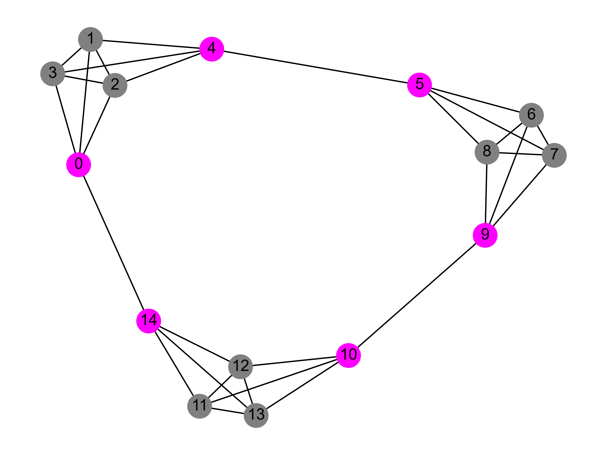
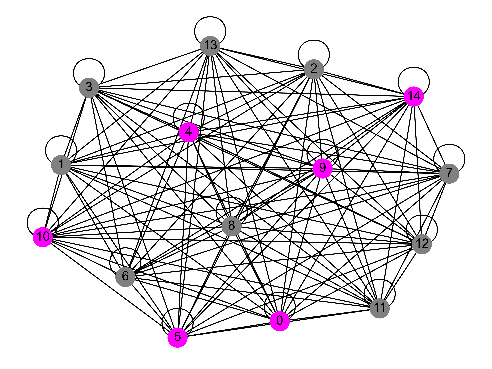
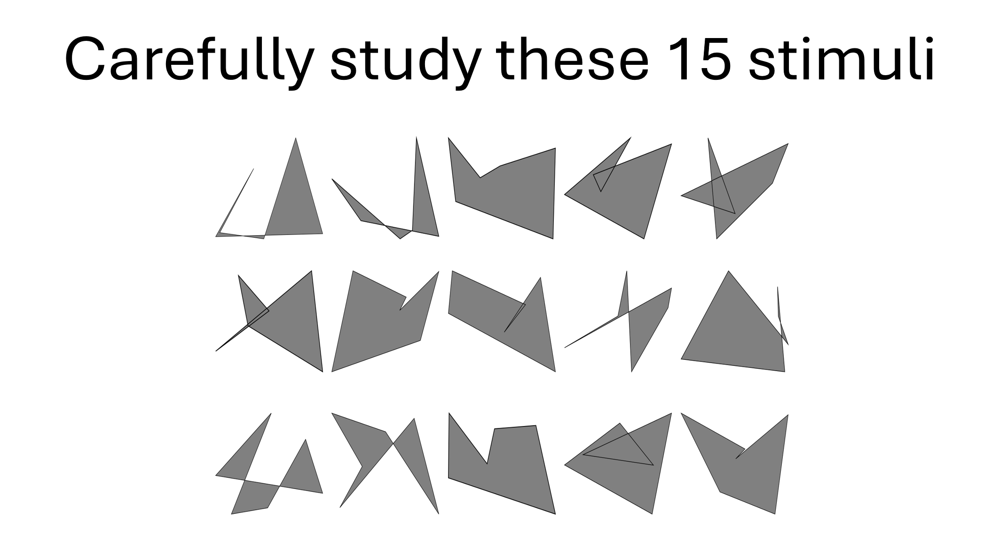
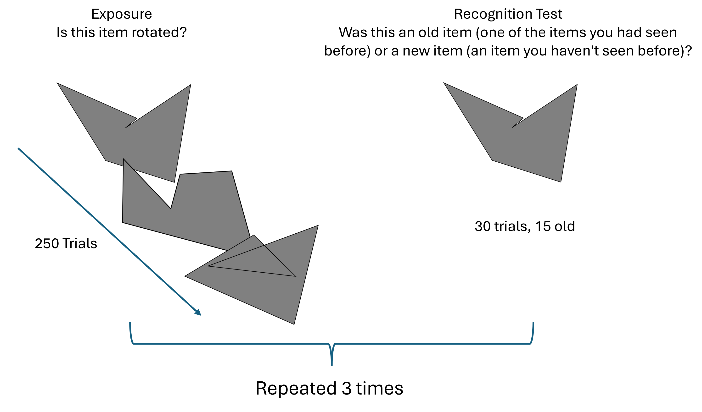
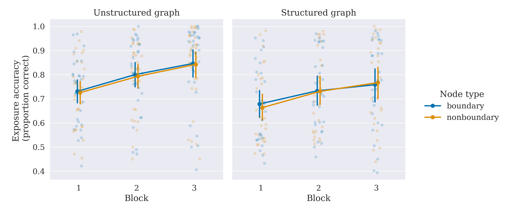
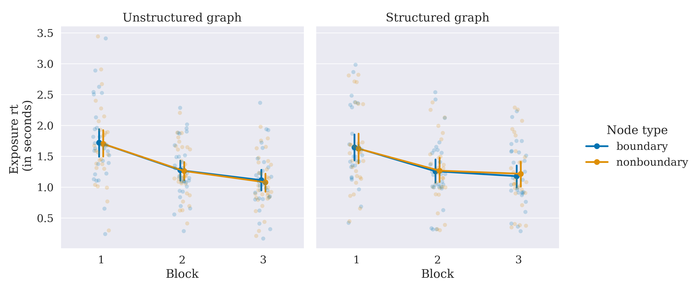
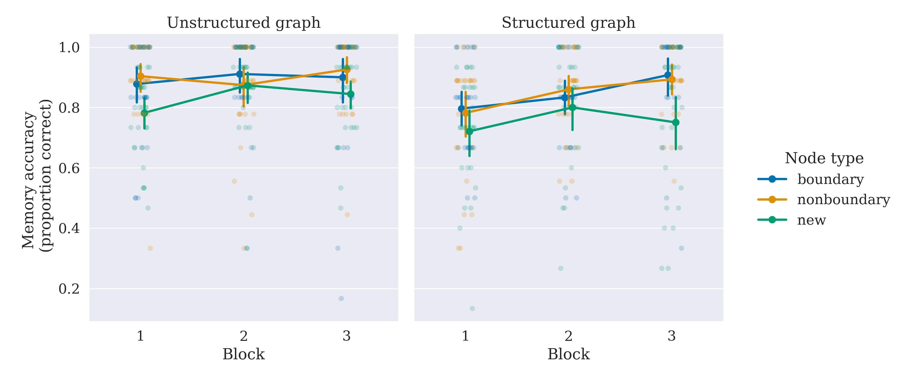
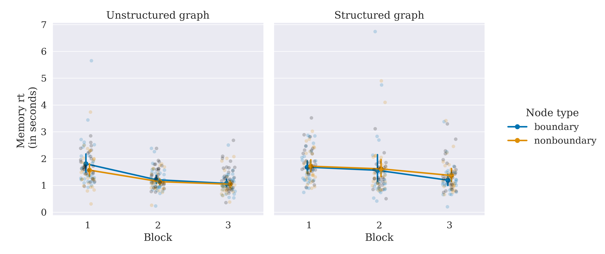
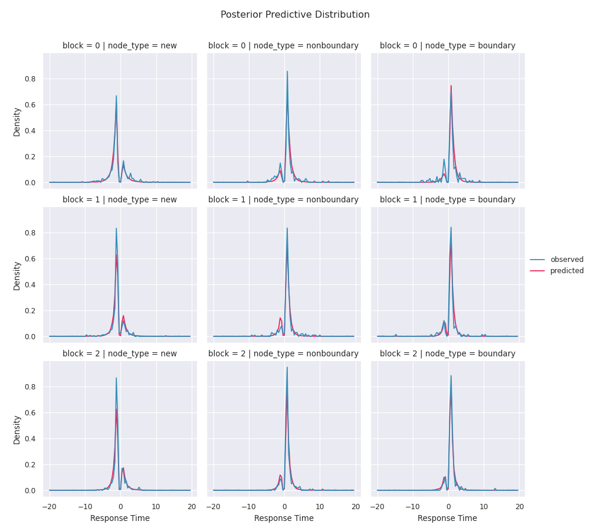
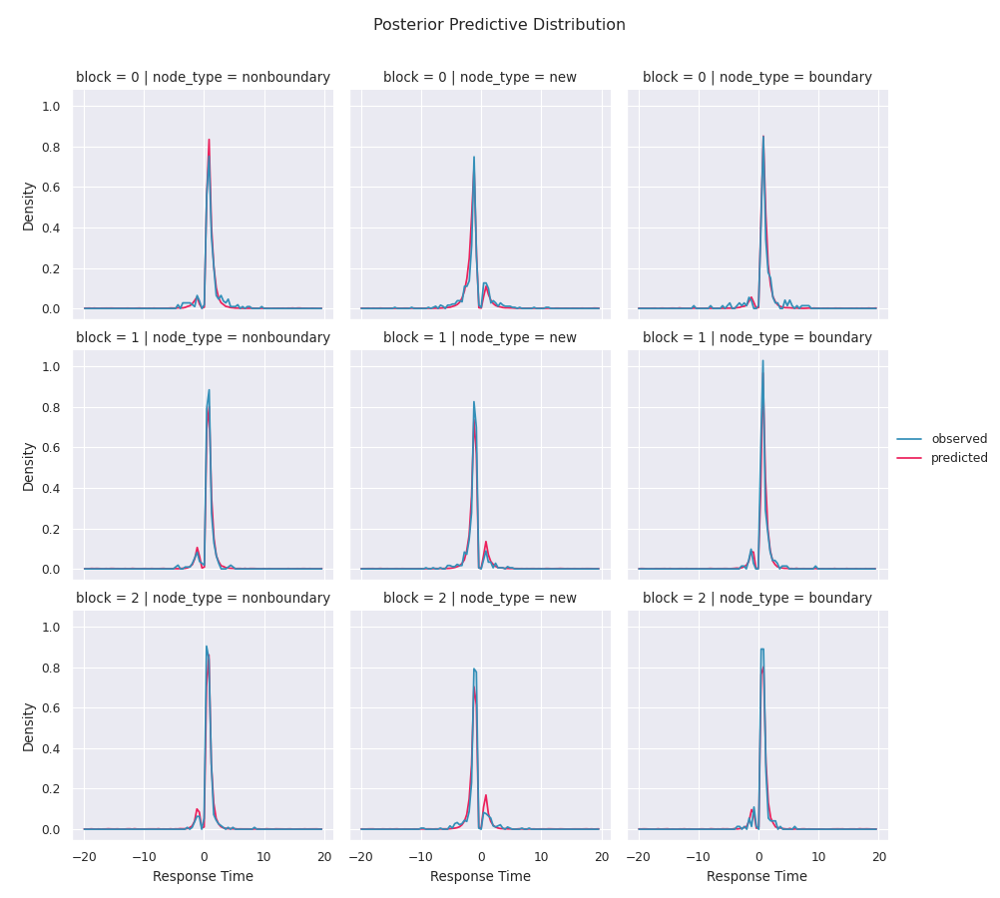

# Abstract 

Changes in temporal context have been shown to impact episodic memory of the 'boundary' items involved in creating this temporal context. However, in most prior studies, changes in temporal context have been operationalized explicitly, typically through perceptually obvious visual or auditory stimuli that form a boundary between the previous and current context. In this work, we explore how recognition of items is impacted when temporal context change is operationalized implicitly through the order of presentation during the study phase. 57 participants, were exposed to a rotation judgment cover task for 15 randomly generated polygon items. Around half of the participants were presented with these items in a random order. The other half were presented with items such that 6 items formed ‘boundaries’ that led in and out of 3 temporal clusters. Similar to findings where boundaries are explicitly operationalized, we show that implicit boundaries are also better remembered than non-boundary items.

# Introduction

We receive a continuous stream of sensory information in our daily lives. In order to make sense of it, we often parse it into meaningful chunks for storage, retrieval, and comprehension. For example, we may recall our drive to work as a series of discrete events: getting into the car, getting coffee, picking up a carpool colleague, hitting traffic on a particular street, parking, and walking over to the office. What aspects of the incoming stream help us organize continuous temporal information in discrete chunks? Cognitive psychologists have studied temporal chunking under several domains from event boundaries [@clewett2019transcending; @zacks2007event; @rouhani2020reward; @rouhani2018dissociable; @dubrow2013influence; @baldwin2008segmenting], language learning, [@romberg2010statistical; @knowlton1992intact], categorization [@unger2022ready; @gabay2015incidental], and motor sequencing [@bera2021motor; @tremblay2010movement; @savalia2016unified; @ostlund2009evidence]. Chunking a repeated sequence of experiences is crucial to abstracting patterns in the environment and forming habits for quick and efficient interactions with the environment [@dezfouli2012habits; @smith2016habit; @dolan2013goals; @dezfouli2014habits; @gershman2010learning; @botvinick2012hierarchical].

[Event boundaries are traditionally demarcated by changes in the ongoing context, where context is often operationalized, explicitly by visual or semantic properties of the stimuli. Event segmentation models suggest that these boundary points serve a unique purpose in parsing the continuous stream of information that we receive. In particular, event boundaries contribute to both the segmentation of the continuous stream and the integration of information within these boundaries.]{style="color: black"} These event boundaries are, for example, shown to be remembered better [@swallow2009event; @rouhani2018dissociable; @rouhani2018dissociable; @zacks2020event; @radvansky2017event; @heusser2018perceptual], serve as points of retrieval [@michelmann2023evidence] and points of replay to promote long term memory [@hahamy2023human; @sols2017event] and easy parsing, help integrate memory across time [@clewett2019transcending], and separate across boundary events while collapsing within boundary events [@clewett2019transcending; @lositsky2016neural; @ezzyat2014similarity; @brunec2018boundaries].

In most prior studies, event boundaries have been studied using explicit, typically visual context shifts. For example, @heusser2018perceptual showed participants a stream of images surrounded by colored borders that visually operationalized context. Event boundaries were therefore operationalized by changing the color of the surrounding border after a few trials. Event boundaries as a function of explicit context change have also been operationalized by changing the associated stimulus [@ezzyat2014similarity] -- participants were presented with a pair of images on each trial, with the 'scene' image in the pair remaining constant for a short sequence of trials, creating a context, amid trial-unique the target images ('object' or 'face'). As participants made judgments about the target image category, the associated scene occasionally changed, thus creating an event boundary [@ezzyat2014similarity]. In these and other previous studies on event boundaries, context changes were operationalized as perceptual or semantic shifts in ongoing sets of events that were visually presented to participants [@swallow2009event; @baldassano2017discovering]. In more recent work, context change has also been operationalized as changes in ongoing reward contingencies associated with each stimulus [@rouhani2020reward].

Consistent findings across most studies in explicitly operationalized event boundaries, events or stimuli in an experimental paradigm that signal a shift in the ongoing context, show that event boundaries are often remembered better [@swallow2009event; @radvansky2017event; @heusser2018perceptual; @clewett2019transcending; @rouhani2020reward; @ezzyat2014similarity; @baldassano2017discovering]. Furthermore, events separated by explicit boundaries are perceived to be farther apart than events within boundaries, implying that events across boundaries are represented to be more distinct than events within boundaries [@clewett2019transcending; @ezzyat2014similarity; @brunec2018boundaries; @lositsky2016neural].

Recent work has shown that event boundaries can also be formed *without* explicit, perceptual changes in context. @schapiro2013neural showed participants a series of meaningless shapes. Unknown to the participants, the stream followed a modular graph structure (see Figure [1](#fig:experiment-design){reference-type="ref" reference="fig:experiment-design"}) where each shape was associated with a node of the graph and connections represented an equal probability of transitioning between nodes. After being exposed to the stimulus stream generated by such a random walk through the modular graph, participants were asked to hit a key when they felt there was a natural break in the stream. Participants pressed the key when they experienced the stream transition between clusters more frequently than when they experienced the stream between nodes within clusters. This finding has been linked to statistical learning of temporal graph structures and the effect of event boundaries is often measured by slowed reaction times when responding to a stimulus after experiencing a transition across-clusters than within-clusters in both visual and motor domains [@karuza2022value; @karuza2019human; @kahn2018network; @kahn2018network; @lynn2020abstract; @lynn2020human; @lynn2020humans].

Crucially, in these studies, unlike most explicit boundary experiment designs, there are no systematic perceptual differences between the stimuli associated with the boundary nodes and those associated with non-boundary nodes (See Figure [1](#fig:experiment-design){reference-type="ref" reference="fig:experiment-design"}, for example). Boundaries are instead operationalized solely as a function of the temporal order in which these stimuli are presented. These implicitly operationalized boundaries (boundaries *not* marked by change in perceptual context) have been labeled as 'event boundaries', suggesting that implicit boundaries share representational properties with explicitly operationalized boundaries typically studied in the event boundary literature [@schapiro2013neural]. However, past studies on implicit event boundaries have not assessed the memory representations of these boundaries using the same tests used in explicitly operationalized boundary paradigms, instead relying on observations from reaction times or the rate at which boundaries are detected as 'natural breaks' in a post-exposure parsing task [@schapiro2013neural]. Testing whether the two types of event boundaries share effects on memory will thus provide direct evidence for a common mechanism underlying boundary formation and provide a unifying framework to study event cognition.

In this work, we test implicitly operationalized boundaries to assess whether they elicit the same behavioral properties as explicitly operationalized boundaries. In particular, we exposed participants to randomly generated meaningless polygon stimuli such that the trial order was structured by the graph structure previously used in [@schapiro2013neural] in contrast to a random, unstructured trial order. We then tested whether participants exposed to structured trial order recognized boundary items better (or worse) than non-boundary items. To preview our results, implicit boundary events are indeed recognized better than non-boundary events, providing support for a shared representation with explicitly operationalized boundaries.

# Method

## Participants {#participants .unnumbered}

63 undergraduate students at the University of Massachusetts Amherst participated in this study. Participants were at least 18 years of age and were compensated via course credit. All study procedures were approved by the University Institutional Review Board, and all participants provided their informed consent for participating in this research study. Data from 6 participants who did not complete the study were discarded from further analyses. The participant sample size was not pre-determined via a statistical procedure but was equivalent to that of similar previous studies [@heusser2018perceptual].

## Stimuli {#stimuli .unnumbered}

Random closed polygons were generated to be used as stimuli for this experiment by connecting 6 vertex locations. The vertices of the polygons were pseudorandomly generated as follows: Cartesian coordinates of two vertices were drawn from a normal distribution centered around 0 with a standard deviation of 0.1 inches. The coordinates of the remaining four vertices were drawn from uniform distributions between 0.1 and 0.3 inches (i.e., the other 4 coordinates were at least 0.1 inches and at most 0.3 inches away from the center). A total of 300 polygons were generated, and 60 (15 were 'old' (studied) and 45 were 'new' (unstudied)) were randomly chosen from this set of 300 and used for each participant (See Figure [1](#fig:experiment-design){reference-type="ref" reference="fig:experiment-design"} for examples). All presented stimuli were set to occupy 17.5% of the height of the visual display.

## Design and Procedures {#design-and-procedures .unnumbered}

Participants were randomly assigned to either a structured graph exposure or an unstructured graph exposure group. The overall experimental procedures were the same across both groups.

The experiment consisted of 3 phases: study, exposure, and test. The study phase was shown once at the beginning of the study. The exposure and test phases were interleaved and repeated three times. Each exposure phase consisted of 250 trials, and each test phase consisted of 30 trials.

From the set of 60 stimuli chosen for each participant, 15 were randomly chosen as 'old' stimuli to be studied during the study and exposure phases. The remaining 45 were set to be used as 'new' items across the 3 recognition memory test phases described below (15 per test). The study phase was always at the beginning of the experiment, where participants were shown all 15 polygons in a 3x5 grid (See Figure [1](#fig:experiment-design){reference-type="ref" reference="fig:experiment-design"}). They were asked to carefully examine these polygons and to remember their orientation, as they would be tested on polygon orientations in the next phase of the experiment. After 4 seconds of the study phase, participants were presented an option to move to the next phase once they were ready -- thus ensuring they viewed all 15 items for a minimum of 4 seconds. The study phase was followed by interleaved exposure and test phases phase for 3 blocks (See Figure [1](#fig:experiment-design){reference-type="ref" reference="fig:experiment-design"}). For each block of 250 exposure trials, participants were presented with one of these 15 polygons at a time and asked to judge whether the presented polygon was in its original orientation or rotated -- the presented orientation was randomly determined to be the canonical orientation shown during the study phase or rotated by $90^\circ$ clockwise or counterclockwise. Participants were provided feedback on their accuracy on each rotation judgment response, and an on-screen score was maintained in the top right corner to motivate accurate responses. Polygons were surrounded by a (purple, orange, or dark green) colored border to use for a later source memory test. The colored border was randomly assigned to each polygon for the study, with each color assigned to 5 of the 15 exposure polygons.

Each polygon with its border was associated with a node in the graphs shown in Figure [1](#fig:experiment-design){reference-type="ref" reference="fig:experiment-design"}. The edges of the graphs determine the order in which the polygons were shown to participants during exposure. The trial order was determined by a random walk through these graphs -- following each trial (i.e., presentation of a polygon associated with a node), the subsequent trial was determined by a random selection between all connected nodes (hence their associated polygons). For 27 participants in the structured exposure group, the trial order was determined by a random walk through the structured modular graph (Figure [1](#fig:experiment-design){reference-type="ref" reference="fig:experiment-design"}A) and for 30 participants in the unstructured exposure group, it was determined by a random walk through the unstructured graph (Figure [1](#fig:experiment-design){reference-type="ref" reference="fig:experiment-design"}B). Magenta nodes in Figure [1](#fig:experiment-design){reference-type="ref" reference="fig:experiment-design"}A are 'boundary' nodes that lead into and out of a cluster, whereas gray nodes are 'non-boundary' nodes. Note that the unstructured graph does not have boundary nodes in function, but to maintain the number of nodes assigned as boundaries and non-boundaries consistent across the two conditions for analyses, 6 corresponding nodes in the unstructured graph are labeled 'boundary' with 9 others serving as 'non-boundary' nodes. Finally, unlike in the structured graph condition, the same polygon could be presented in consecutive trials (as denoted by node recurrent connections).

<figure id="fig:experiment-design">
<figure>

<figcaption aria-hidden="true"></figcaption>
</figure>
<figure>

<figcaption aria-hidden="true"></figcaption>
</figure>
<figure>

<figcaption aria-hidden="true"></figcaption>
</figure>
<figure>

<figcaption aria-hidden="true"></figcaption>
</figure>
<figcaption>Design schematic for the experiment. <strong>A</strong>. Modular Graph for participants in the structured exposure group. <strong>B</strong> Graph used for participants in unstructured exposure group. Magenta nodes in both graphs are labeled boundary nodes for analyses. <strong>C</strong> Study phase showing all 15 polygons that will be shown one at a time during exposure. <strong>D</strong> Three alternating blocks of sequence exposure and recognition test were presented. A Stroop task was conducted prior to the final recognition test.</figcaption>
</figure>

After each block of the exposure phase, participants went through a recognition memory test (Figure [1](#fig:experiment-design){reference-type="ref" reference="fig:experiment-design"}). They were shown the 15 'old' items from the exposure phase (in their original orientation) in addition to 15 new random polygon items (chosen from the set of 45 selected for each participant) and were asked to determine whether each of these polygons was old or new. The order of presentation of old and new items was randomized during the recognition memory test. A Stroop task was used prior to the recognition test of the third (final) block to wash out any effects of short-term memory. We avoided using the Stroop task before the recognition tests of the first two blocks to avoid longer, additional task-switching breaks in the continuous exposure sequences hence allowing the participants to develop a representation of the underlying transition structure.

After the final recognition memory test, participants went through a source memory test. Each of the 15 studied items was shown without the colored borders that surrounded them during exposure. Participants were asked to choose which of the three colored borders, provided as on-screen options, surrounded any particular item. This source memory task was added to provide an additional signal for memory in case of ceiling effects of recognition memory tasks. However, no analyses have been done on this source memory task.

#### Software note.

The experiment was designed using Psychopy [@peirce2007psychopy], and conducted on desktop computers running Windows 7 with a resolution of 1920x1080. All linear models presented in the next section were conducted using the Python package Bambi [@capretto2022bambi], whereas the Drift diffusion model was fit using the HSSM toolbox [@fenglerhssm]. Model comparisons and visualizations were created using Arviz [@kumar2019arviz] and Seaborn [@waskom2021seaborn].

# Results

The overall average accuracy and median response time patterns during the exposure phase, for each participant across node and graph types for the three exposure blocks, are shown in Figure [4](#fig:exposure-stats){reference-type="ref" reference="fig:exposure-stats"} (See Table [1](#tab:exp2-rt-accuracy-stats){reference-type="ref" reference="tab:exp2-rt-accuracy-stats"} for complete descriptive statistics). Exposure accuracy is measured by the proportion of trials in which participants correctly recognized the canonical orientation of the polygons. Since participants are given feedback on their rotation judgment during exposure, we expect that this rotation judgment accuracy will increase and reaction times will decrease over trials.

To estimate the learning effects, we fit a Bayesian hierarchical mixed effects logistic regression model for rotation judgment accuracy and a hierarchical mixed effects linear regression model to estimate the rotation judgment [log]{style="color: black"} reaction times. The models included main effects of node type (boundary vs non-boundary), graph-type (structured vs unstructured), and (log) trial number along with 2- and 3-way interactions between all factors and a varying participant intercept. As expected, rotation judgment accuracy increased (log trials $\beta = 0.13$, $95\%$, HDI \[0.08, 0.17\]) and [log]{style="color: black"} response times decreased ([log trials $\beta = -0.21$, $95\%$, HDI \[-0.22, -0.19\]]{style="color: black"}) with exposure. While we find no reliable main effects of graph type on response times or accuracy, we observe mixed effects of node type on both response times and accuracy measures, along with interactions with other factors (such as graph type) in our models. (See Tables [2](#tab:exposure_rts){reference-type="ref" reference="tab:exposure_rts"} and [3](#tab:exposure_accuracy){reference-type="ref" reference="tab:exposure_accuracy"} for complete model statistics).

If participants accurately recognize the orientation of exposure items, they are also likely to recognize these items better at test, regardless of their role in the underlying graph structure. Thus, differences in exposure accuracy may impact our key measure of interest. i.e., recognition accuracy. To account for possible differences in encoding at exposure, we include exposure accuracy as a covariate in our analysis of recognition memory below.

<figure id="fig:exposure-stats">
<figure id="fig:acc-exposure">

 

</figure>
<figure id="fig:rt-exposure">

 

</figure>
<figcaption>(Top panels) Mean accuracy and (Bottom panels) response times at exposure in the rotation judgment task separated by graph type (left vs right panels) and node type (hue). Error bars are 95% CI across participants. Behavioral measures are collapsed across trials within a block and participants for plotting. Statistical tests were performed on trial-level data.</figcaption>
</figure>

### Diffusion Modeling {#diffusion-modeling .unnumbered}

The overall recognition accuracy and response time data separated by the test stimuli types (new, boundary, and non-boundary) are shown in Figure [7](#fig:memory-results){reference-type="ref" reference="fig:memory-results"}.

<figure id="fig:memory-results">
<figure id="fig:acc-memory">

 

</figure>
<figure id="fig:rt-memory">

 

</figure>
<figcaption>(Top panels) Mean accuracy and (Bottom panels) response times in the recognition memory test separated by graph type (left vs right panels) and node type (hue). Error bars are 95% CI across participants. Behavioral measures are collapsed across trials within a block and participants for plotting. Statistical tests were performed on trial-level data.</figcaption>
</figure>

To assess the recognition memory differences between the boundary and non-boundary items and leverage variability in response times, we use the Drift Diffusion Model (DDM, Figure [8](#fig:ddm-model){reference-type="ref" reference="fig:ddm-model"}) commonly used in choice tasks. The DDM, which falls under a class of sequential sampling models, has been a widely successful model in modeling two-choice tasks in recognition memory [@ratcliff2004diffusion; @ratcliff2022discriminating; @starns2014using; @starns2014validating; @ratcliff2009modeling].

![[The Drift Diffusion Model of Choice Response Times for Old/New recognition memory tasks. The two-alternative decision task is represented by two boundaries, where the ceiling corresponds to 'old' responses and the floor corresponds to 'new' responses. Corresponding distributions are hypothetical response time distributions for 'old' and 'new' responses, respectively. The separation of the boundaries is modeled by the boundary parameter '$a$'. The sequential sampling process starts at point '$z$', which represents a bias towards old or new responses. Noisy evidence towards the old or new boundary is accumulated at a drift rate '$v$'. '$t_{er}$' represents the time spent in non-decision processes (e.g., perceiving the stimuli, and enabling motor effectors for response)]{style="color: black"}](figures/ddm.png){#fig:ddm-model width="75%"}

Briefly, the DDM assumes that at the time of choice, evidence from the presented test item accumulates sequentially over time towards one of the two boundaries. For a previously studied item presented at test, the evidence tends to accumulate noisily towards the 'old' boundary whereas for a non-studied item, the evidence accumulates towards the 'new' boundary. The rate of evidence accumulation is controlled by the drift rate parameter, $v$. A more positive $v$ would imply more likely evidence accumulation towards the old boundary, whereas a more negative $v$ implies more likely evidence accumulation towards the new boundary. Participants may be biased towards making an old or a new response at test; this bias is measured by the starting point parameter, $z$. The boundary separation parameter $a$ determines how the amount of evidence that needs to be accumulated to make a decision -- a larger $a$ implying a difficult task or cautious responses. Finally, the observed response consists of cognitive processes not affiliated with decision-making (such as time for the motor systems to click the relevant key once a decision has been made) which are modeled by a non-decision time parameter $t_{er}$.

Prior work has shown that the memory strength of previously studied items impacts the drift rate towards old/new responses [@ratcliff2004diffusion; @ratcliff2022discriminating]. A higher positive drift rate parameter implies a stronger match to items in memory which leads to a quicker accumulation of evidence towards the 'old' response boundary. Similarly, a stronger mismatch to memory (as measured by the higher negative drift rate parameter) implies a quicker accumulation of evidence towards the 'new' response boundary [@ratcliff2004diffusion; @ratcliff2022discriminating].

If implicitly operationalized event boundaries in this study indeed share representations with explicitly operationalized event boundaries, the memory strength of the boundary node items should be enhanced relative to those non-boundary node items for participants exposed to a random walk through the structured graph. No such difference is expected for participants exposed to a random walk in an unstructured graph, since there are no functional boundary nodes.

The drift rate parameter of the DDM has been associated with memory strength [@starns2014using]. The drift rate should thus be higher for boundary nodes for structured random walk participants than for non-boundary nodes. This difference in boundary vs non-boundary item drift rates should be relatively higher for participants exposed to a random walk in the structured graph than for the participants in our control condition. On the other hand, for participants exposed to a random walk in the unstructured graph, the drift rates between items assigned boundary and non-boundary *labels* should be equivalent.

To test this hypothesis, we parameterized the DDM for the recognition tasks in our study as follows: $$\begin{aligned}
        v \sim 0 + exposure\ accuracy + node\ type + (node\ type|participant)\\
        z \sim block + (1|participant) \\
        a \sim block + (1|participant) \\
        t_{er} \sim (1|participant)
    \end{aligned}$$

We allow the drift rate parameter, *v* to vary for each node type (note that for recognition tests, node types are labeled 'boundary', 'non-boundary', and 'new') with accuracy at exposure as a covariate. For old items, the accuracy at exposure was the proportion of trials participants correctly recognized the true orientation in the exposure block immediately before the current test block. For new items, accuracy at exposure was fixed at the average accuracy across all old items -- thus assuming that the stronger encoding of an old item improves recognition of a new item. We further assumed that over time, as participants get more familiar with the old items through repeated exposure, the amount of evidence required for them to choose an old/new response at test will be lower. We thus allowed the boundary parameter to change per block [^1]. We also allowed the choice-bias parameter, *z*, to change over blocks to account for changing biases during the experiment. Finally, the non-decision time parameter was allowed to vary for each participant to account for individual differences in non-decision processes. [The noise coefficient (scaling parameter) used for our modeling work is set to 1.]{style="color: black"} We also compared the models including node type to models without node type as a factor affecting drift rate for both structured and unstructured participants, along with including/excluding block effects in all parameters and present the model that best fit our data (See Tables [6](#tab:model-compare-struct){reference-type="ref" reference="tab:model-compare-struct"} and [7](#tab:model-compare-unstruct){reference-type="ref" reference="tab:model-compare-unstruct"} for comparison results and Figures [12](#fig:ppc-structured){reference-type="ref" reference="fig:ppc-structured"} and [13](#fig:ppc-unstructured){reference-type="ref" reference="fig:ppc-unstructured"} for posterior predictive distributions from the winning model to visualize model fits).

#### DDM Results {#ddm-results .unnumbered}

The modeling framework above incorporates response time distributions during recognition memory tasks. In particular, if an item is quickly and accurately recognized as old or new, in addition to good accuracy, such recognition would result in faster reaction times. This effect is captured by the drift rate parameter of the DDM.

We tested whether boundary nodes have a higher drift rate than non-boundary nodes (operationalized implicitly as a function of the structured-graph-based trial order during exposure) by subtracting the posterior samples of the drift rate parameter for stimuli associated with non-boundary nodes from those associated with boundary nodes for both unstructured (control) and structured (experimental) graph types (Figure [9](#fig:ddm-results){reference-type="ref" reference="fig:ddm-results"}). We find that 95.6% of the posterior parameter difference between non-boundary and boundary node stimuli in the structured condition was above 0 ($M = 0.15, 95\%\ HDI:[-0.035, 0.287]$[^2]. In comparison, 49.6% of this difference distribution was above 0 for the unstructured condition ($M = 0, 95\%\ HDI: [-0.16, 0.17]$) [^3].

We estimate the effect of interactions between node-type-dependent drift rate differences and conditions by subtracting the posterior difference estimates. While this difference of differences is not reliably above 0 ($M = 0.147, 95\%HDI\ [-.084, .384]$) the interaction effect strongly trends towards statistical reliability with $88.8\%$ of posterior difference of differences samples above 0. [Note that while we label 6 nodes in the unstructured graph as 'boundary' nodes, functionally, these are no different from non-boundary nodes, as each stimulus is randomly assigned to each node and each node is in turn connected to every other node of the graph. Results presented in Figure 5 come from a single random assignment of these nodes as boundary or non-boundary.]{style="color: black"}

![[Drift rate differences distributions. Differences between group-level posterior distributions of boundary and non-boundary nodes for unstructured (blue) and structured (orange) exposure conditions. A higher difference distribution implies faster drift rates for stimuli associated with boundary nodes. A significant proportion of the posterior samples of the difference distribution is above 0 for the structured (experimental) condition whereas the difference distribution is centered around 0 for the unstructured (control) condition.]{style="color: black"}](figures/ddm_results.png){#fig:ddm-results width="\\textwidth"}

See Table [4](#tab:ddm-params-structured){reference-type="ref" reference="tab:ddm-params-structured"} and [5](#tab:ddm-params-unstructured){reference-type="ref" reference="tab:ddm-params-unstructured"} for full parameter statistics of the DDM for structured and unstructured conditions respectively. Interestingly, in both unstructured (*M(a block 1) = -0.17, 95%HDI \[-0.21, -0.13\]*, *M(a block 2) = -0.24, 95%HDI \[-0.29, -0.2\]*) and structured (*M(a block 1) = -0.18, 95%HDI \[-0.23, -0.13\]*, *M(a block 2) = -0.19, 95%HDI \[-0.23, -0.14\]*) graph conditions, the boundary parameter *a* is reliably lower in blocks 2 and 3 relative to block 1 implying that participants do seem to require less evidence in the later blocks to make their old or new decision. The bias parameter is lower for blocks 2 and 3 relative to block 1 in the unstructured graph condition (*M(z block 1) = -0.05, 95%HDI \[-0.07, -0.02\], M(z block 2) = -0.03, 95%HDI \[-0.06, -0.01\]*) but mixed in the structured graph condition (*M(z block 1) = -0.03, 95%HDI \[-0.06, -0.01\], M(z block 2) = -0.01, 95%HDI \[-0.03, 0.02\]*) implying that participants may alter their bias towards new responses in subsequent memory tests albeit, these bias effects, if they exist, are very small. Finally, new item recognition appears to be faster in the unstructured condition (*M = -1.19, 95%HDI \[-1.5, -0.89\]*) than in the structured condition (*M = -0.84, 95%HDI \[-1.18, -0.52\]*).

The diffusion modeling results thus provide evidence that items that serve as implicit, temporally defined, boundary events are remembered better than items that serve as non-boundary events. Our control condition which accounts for the number of items serving as boundary vs non-boundary nodes but does *not* assign a functional event boundary role do not show this difference. These findings thus suggest a shared memory representation between implicit and explicit event boundaries.

## Converging evidence for better implicit boundary memory using alternative metrics

[We test our hypothesis using two additional metrics to evaluate the reliability of findings using the DDM model. First, we use the **Balance Integration Score** (BIS) as proposed in @liesefeld2015fast to test whether boundary nodes in structured graph conditions are better remembered while accounting for speed-accuracy trade-offs and providing for equal weighting of response times and accuracy measures [@liesefeld2019combining]. We compute BIS by first z-scoring the proportion correct and response time measures for each participant and node type and then subtracting the standardized response times from the standardized proportion correct measures. Our BIS distribution through this standard calculation was left-skewed, likely due to near-ceiling accuracies. Thus, we power-transformed our BIS scores and fit the following linear mixed effects model separately to structured and unstructured graph conditions:]{style="color: black"}

$$2^{BIS} ~ 0 + node type:block + accuracy\ exposure + (1|participant)$$

{#fig:bis-scores width="85%"}

[In line with our findings using the DDM, as shown in Figure [10](#fig:bis-scores){reference-type="ref" reference="fig:bis-scores"}, we observe a reliably higher BIS for boundary compared to non-boundary nodes in the structured condition (node type : block M = 0.09, SD = 0.05, 95% HDI \[0.01, 0.18\]) and not in the unstructured condition (node type : block M = -0.04, SD = 0.04, 95% HDI \[-0.12, 0.04\]). ]{style="color: black"}

[It is possible that the effects we observed are due to incidental correlations between graph and node types and between subject variability. To ensure robustness of our estimates, we also perform a bootstrap analysis where we assign 'boundary' and 'non-boundary' labels to 100 random samples of the 15 nodes for each participant and re-fit our models for both structured and unstructured graph conditions (Figure [11](#fig:boot-analysis){reference-type="ref" reference="fig:boot-analysis"}). Specifically, we randomly assigned boundary or non-boundary labels to our stimuli 100 times. We fit the same DDM parametrization to these 100 random assignments and extracted the posterior drift rate estimates for memory responses to these boundary and non-boundary labeled items. We then subtracted these drift posterior estimates for non-boundary stimuli from those of the boundary stimuli (similar to analyses presented in Figure [9](#fig:ddm-results){reference-type="ref" reference="fig:ddm-results"}). We then computed the mean of these difference distributions to build a bootstrapped empirical null distribution and computed the proportion (out of 100) of both empirical null distributions (from structured and unstructured conditions) that are higher than the mean difference for our true boundary-non-boundary assignment conditions.]{style="color: black"}

{#fig:boot-analysis width="85%"}

[As seen in Figure [11](#fig:boot-analysis){reference-type="ref" reference="fig:boot-analysis"}, we find that only 6% of structured empirical null distribution samples are higher than the true estimated mean and 13% of unstructured empirical null distribution samples are higher than the true estimated mean, providing further support to our modeling results, indicating that boundary nodes in structured graphs have a higher drift rate during the later recognition test than non-boundary nodes. This analysis suggests that the probability of observing the node type group level effects in our results by chance is relatively small.]{style="color: black"}

# Discussion

The primary goal of this work was to test whether findings in the explicitly operationalized event boundary literature replicate when boundaries are operationalized implicitly, through temporal statistics *without* perceptual context changes. Shared properties between these two operationalizations of event boundaries imply shared representations in memory, thereby providing a framework for future research to study shared algorithmic processes that lead to the formation of event boundaries. In particular, we test whether, similar to findings in the explicitly operationalized event boundary literature (where boundary events are perceptually different from the ongoing stream of events), participants remember implicitly operationalized boundary events (where boundary events are not perceptually different but serve as a gateway to a different cluster defined by temporal co-occurrences). We use the drift-diffusion model on our empirical results to show that boundary nodes are remembered better than non-boundary nodes even when boundaries are not operationalized explicitly.

In this work, we use the DDM to measure differences in memory strength between boundary and non-boundary nodes. DDM is one (highly successful) model of memory that incorporates response time distributions along with choices. Several other sequential sampling models can be similarly used in this formulation to provide evidence of better memory strength for boundary items. Most notably, a direct extension of the Generalized Context model for recognition memory is the Exemplar Based Random Walk (EBRW) model [@nosofsky2011short] which assumes that evidence towards old/new recognition choice options is accumulated in proportion to background activation of all items in memory may be extended to incorporate non-boundary items as background activation with boundary items providing an additional boost in its evidence accumulation process. Recent extensions of the DDM also incorporate reinforcement learning-driven modulation of drift rates which may provide a dynamic characterization of memory processes during learning [@pedersen2017drift]. Further work is needed to understand how extensions to DDM and other choice reaction time models can be extended to incorporate the effects of temporal order.

The effect of structured exposure on identifying new stimuli is intriguing (Tables [4](#tab:ddm-params-structured){reference-type="ref" reference="tab:ddm-params-structured"}, and [5](#tab:ddm-params-unstructured){reference-type="ref" reference="tab:ddm-params-unstructured"}). The drift rate posteriors for new items for participants in the unstructured exposure condition are faster (more negative) than for participants in the structured exposure condition. Likely, the interleaved presentation in unstructured exposure generally provides for a richer representation of each exemplar in memory especially in comparison to the non-boundary items in the structured exposure condition, thereby allowing for easier discrimination with new items at test. A similar benefit of interleaved presentation has been observed in categorization tasks [@carvalho2014putting; @carvalho2017sequence]. Nevertheless, future work should aim to explain the cognitive processes that lead to better recognition of new items in the absence of structured learning.

[We use the DDM to model participant behavior during the recognition test phase and particularly rely on drift rates to identify the differences in memory of items associated with boundary and non-boundary nodes. The DDM models the psychological process of sequentially sampling evidence towards the 'old' or 'new' boundary after having viewed the stimulus. The drift rate parameter of the DDM controls the speed at which this evidence is accumulated towards either boundary of the DDM, with a higher drift rate implying greater speed, thus enabling faster recognition for old items along with higher hit rates (Figure S2). In the context of our experiment, the higher drift rate for boundary nodes, relative to non-boundary nodes, implies that boundary items are more readily available in memory and are therefore recognized faster. In particular, even when stimuli are meaningless and non-verbalizable, if they functionally serve as *implicit* bottlenecks in the ongoing temporal experience, they show properties of typical explicitly operationalized event boundaries. Our findings thus add to prior work indicating the boundary items serve a special role in the structuring of memory and its recall by serving as access points of memory retrievalbott [@michelmann2023evidence; @heusser2018perceptual; @karuza2019human].]{style="color: black"}

[The addition of prior exposure accuracy in our modeling may introduce unwanted effects. For example, prior accuracy may be related to node type. Furthermore, since our items were randomly generated, it is possible that some items were verbalizable, enabling participants to remember them better. It is also possible that the random walk during exposure led to greater exposure to some items than others. Additionally, it is also possible that the randomized presented rotation led to participants spending more time studying some items since they were harder to mentally rotate. Thus, if participants remembered an item better during exposure as a result of any of the above-stated reasons, we expect them to have better recognition memory for those items regardless of their functional role in the temporal graph. Since our goal was to identify whether boundary drift rates were higher *beyond* the specific visual properties of the studied items and experimental variability, by using exposure accuracy as a covariate, we attempted to account for these effects. Nevertheless, exposure accuracy for each stimulus is a crude metric to account for these effects, and future research could better account for the effects of exposure by explicitly controlling the visual properties of the stimuli.]{style="color: black"}

Our results also show an unexpected but interesting effect -- recognition performance (for both old and new items) is generally better for participants in the unstructured graph group than those in the structured graph group. [We speculate that the interleaved nature of exposure presented to the unstructured graph participants may have led to a better overall memory of studied polygons. Such an interleaving benefit has been observed in prior work on the spacing effect [@carvalho2017sequence; @vlach2008spacing; @wang2020benefit]. Furthermore, it is also possible that the difference in lag between repeated presentation of our stimuli and the randomness of the rotation judgment task has contributed to this difference. The random walk nature through a modular graph necessitates that if a module switch occurs after presentation of a stimulus, repeated presentation of that stimulus would occur with a larger lag in the structured condition. This lag may contribute to relatively lower accuracy exposure, as 10 of 15 stimuli at any given time will be presented at a larger lag in this condition (Figure S5). Furthermore, for stimuli presented at smaller lags (i.e., when the random walk traverses within a module), the randomization of the presented rotation may induce an additional bias leading to lower accuracy at exposure.]{style="color: black"} While we account for potential benefits by including accuracy at exposure as a covariate, future experimental design equalizing recognition performance across exposure types should provide stronger evidence towards node-type advantage due to structured graph exposure.

Our experimental work provides evidence that implicit event boundaries, similar to explicit event boundaries, play a special role in organizing implicit memory. However, it is unclear what temporal order learning-driven algorithmic and neural mechanisms may underlie this benefit. Following the prediction error-based account of boundary formation in event segmentation theory, and the implicit nature of our task, it is likely that an algorithmic mechanism that accounts for the establishment of temporal context such as the Temporal Context Model [@howard2005temporal; @polyn2009context] or a predictive-representations based Successor Representation [@gershman2012successor; @dayan1993improving; @momennejad2017successor; @gershman2018successor] may be used to characterize our findings. Neurally, the complementary learning systems (CLS) theorized to be involved in statistical learning in the hippocampus may provide an indication of where differences in boundary vs non-boundary items are represented in the brain [@schapiro2015statistical; @schapiro2013neural; @o2014complementary; @schapiro2017complementary]. Future work should aim to address the underlying algorithmic and neural representations that jointly explain the effects of implicit environmental statistical regularities on memory representations.

Finally, in our experiment, we use a specific graph structure and a random walk through it to investigate possible shared properties of implicit and explicit event boundaries. Future work should aim to generalize this effect by also attempt to identify if altering the properties of various graph topologies can lead to different experimental observations.

# Conclusion

Findings of our empirical study presented in this article show that, similar to explicitly operationalized boundaries, implicitly operationalized boundary events are remembered better than non-boundary events. Our work provides an indication that the underlying mechanisms that learn and represent event boundaries may rely not just on perceptual, but also on temporal regularities, thereby leading to structured organization of memory hinged at event boundaries.

# Acknowledgements

We would like to thank all RDCL and DMM lab research assistants who helped collect data for this article.

# Data Availibility Statement

Code and data used for this manuscript are made openly available in the GitHub repository: <https://github.com/tejas-savalia/implicit-boundary-memory>.

# Funding

No funding was received for work presented in this article.

::: {#tab:exp2-rt-accuracy-stats}
  ------- ------- --------------- -------------- ---------- ------- ------- -------
                                                  accuracy            rt    
                                                    mean      std    mean     std
  phase   block   stimulus type   graph type                                
          0       boundary        structured       0.683     0.465   1.644   1.911
                                  unstructured     0.739     0.439   1.710   1.732
  3-8             non-boundary    structured       0.669     0.471   1.619   1.728
                                  unstructured     0.728     0.445   1.713   1.689
  2-8     1       boundary        structured       0.735     0.441   1.244   1.322
                                  unstructured     0.796     0.403   1.283   1.243
  3-8             non-boundary    structured       0.739     0.439   1.250   1.343
                                  unstructured     0.790     0.408   1.263   1.217
  2-8     2       boundary        structured       0.757     0.429   1.168   1.657
                                  unstructured     0.843     0.363   1.111   1.334
  3-8             non-boundary    structured       0.765     0.424   1.192   1.656
                                  unstructured     0.838     0.369   1.085   1.546
  1-8     0       boundary        structured       0.796     0.404   1.681   1.490
                                  unstructured     0.878     0.328   1.805   1.712
  3-8             new             structured       0.721     0.449   1.899   1.569
                                  unstructured     0.782     0.413   1.770   1.666
  3-8             non-boundary    structured       0.782     0.414   1.715   1.602
                                  unstructured     0.904     0.296   1.570   1.291
  2-8     1       boundary        structured       0.833     0.374   1.564   2.573
                                  unstructured     0.911     0.285   1.212   0.959
  3-8             new             structured       0.800     0.400   1.420   1.486
                                  unstructured     0.873     0.333   1.338   1.056
  3-8             non-boundary    structured       0.860     0.348   1.618   1.812
                                  unstructured     0.874     0.332   1.139   0.709
  2-8     2       boundary        structured       0.907     0.291   1.196   1.194
                                  unstructured     0.900     0.301   1.075   0.694
  3-8             new             structured       0.751     0.433   1.454   2.322
                                  unstructured     0.844     0.363   1.292   1.127
  3-8             non-boundary    structured       0.893     0.310   1.370   1.869
                                  unstructured     0.926     0.262   1.045   0.729
  1-8                                                                       
  ------- ------- --------------- -------------- ---------- ------- ------- -------

  : Continued\...
:::

::: {#tab:exposure_rts}
  -------------------------------------------------------------- ------- ------ ------- -------
                                                                                  HDI   
                                                                  mean     sd    2.5%    97.5%
  Intercept                                                       1.13    0.11   0.91    1.31
  graph type\[unstructured\]                                      0.05    0.15   -0.24   0.33
  log trials                                                      -0.21   0.01   -0.22   -0.19
  log trials:graph type\[unstructured\]                           0.00    0.01   -0.02   0.02
  log trials:node type\[nonboundary\]                             0.01    0.01   -0.01   0.03
  log trials:node type:graph type\[nonboundary, unstructured\]    -0.02   0.01   -0.05   0.00
  node type\[nonboundary\]                                        -0.06   0.05   -0.16   0.05
  node type:graph type\[nonboundary, unstructured\]               0.12    0.07   -0.02   0.25
  -------------------------------------------------------------- ------- ------ ------- -------

  : Effects of trials, node type, and experimental graph type on participant response times during exposure phase. Effects in square brackets are labeled relative to the common intercept.
:::

::: {#tab:exposure_accuracy}
  -------------------------------------------------------------- ------- ------ ------- -------
                                                                                  HDI   
                                                                  mean     sd    2.5%    97.5%
  Intercept                                                       0.46    0.24   -0.02   0.91
  graph type\[unstructured\]                                      -0.38   0.34   -0.97   0.35
  graph type:node type\[unstructured, nonboundary\]               0.34    0.25   -0.15   0.83
  log trials                                                      0.13    0.02   0.08    0.17
  log trials:graph type\[unstructured\]                           0.14    0.04   0.07    0.20
  log trials:graph type:node type\[unstructured, nonboundary\]    -0.06   0.04   -0.15   0.02
  log trials:node type\[nonboundary\]                             0.06    0.03   0.00    0.12
  node type\[nonboundary\]                                        -0.36   0.18   -0.71   -0.01
  -------------------------------------------------------------- ------- ------ ------- -------

  : Effects of trials, node type, and experimental graph type on participant accuracy during exposure phase. Effects in square brackets are labeled relative to the common intercept.
:::

::: {#tab:ddm-params-structured}
  --------------------- ------- ------ ------- -------
                                         HDI   
                         mean     sd    2.5%    97.5%
  z block\[1\]           -0.03   0.01   -0.06   -0.01
  z block\[2\]           -0.01   0.01   -0.03   0.02
  a block\[1\]           -0.18   0.03   -0.23   -0.13
  a block\[2\]           -0.19   0.02   -0.23   -0.14
  v accuracy exposure    0.57    0.14   0.31    0.85
  v boundary             0.63    0.12   0.42    0.88
  v new                  -0.84   0.17   -1.18   -0.52
  v non-boundary         0.49    0.12   0.27    0.72
  z Intercept            0.52    0.01   0.49    0.54
  a Intercept            1.20    0.04   1.11    1.28
  t Intercept            0.44    0.03   0.38    0.49
  --------------------- ------- ------ ------- -------

  : Drift diffusion model parameters for the structured graph type. Effects in square brackets are labeled relative to the common intercept (block 0 for the boundary parameter). Drift rate *v* is estimated for each node type while accounting for accuracy at exposure (in parameter 'v accuracy exposure'.
:::

::: {#tab:ddm-params-unstructured}
  --------------------- ------- ------ ------- -------
                                         HDI   
                         mean     sd    2.5%    97.5%
  z block\[1\]           -0.05   0.01   -0.07   -0.02
  z block\[2\]           -0.03   0.01   -0.06   -0.01
  a block\[1\]           -0.17   0.02   -0.21   -0.13
  a block\[2\]           -0.24   0.02   -0.29   -0.20
  v accuracy exposure    0.51    0.14   0.25    0.80
  v boundary             0.85    0.12   0.62    1.11
  v new                  -1.19   0.16   -1.50   -0.89
  v non-boundary         0.85    0.13   0.61    1.10
  z Intercept            0.53    0.01   0.50    0.56
  a Intercept            1.14    0.04   1.07    1.22
  t Intercept            0.48    0.02   0.44    0.52
  --------------------- ------- ------ ------- -------

  : Drift diffusion model parameters for the unstructured graph type. Effects in square brackets are labeled relative to the common intercept (block 0 for the boundary parameter). Drift rate *v* is estimated for each node type while accounting for accuracy at exposure (in parameter 'v accuracy exposure'.
:::

::: {#tab:model-compare-struct}
                                                       rank   elpd loo   p loo    weight
  --------------------------------------------------- ------ ---------- -------- --------
  v$\sim$nodetype, z$\sim$block, a$\sim$block           0     -3322.44   178.28    0.44
  v$\sim$nodetype+block, z$\sim$block, a$\sim$block     1     -3323.68   183.07    0.42
  v$\sim$nodetype, a$\sim$block                         2     -3325.19   177.83    0.00
  v$\sim$nodetype                                       3     -3357.94   171.50    0.12
  a$\sim$block                                          4     -3947.96   150.93    0.02

  : Results of model comparison between a model with drift rate varying by node type with a model with drift rates independent of node types for participants in the structured graph type. Including node type improves model fits as measured by expected log pointwise predictive density on leave-one-out cross-validation set [@vehtari2017practical].
:::

::: {#tab:model-compare-unstruct}
                                                       rank   elpd loo   p loo    weight
  --------------------------------------------------- ------ ---------- -------- --------
  v$\sim$nodetype, z$\sim$block, a$\sim$block           0     -2810.24   157.96    0.95
  v$\sim$nodetype+block, z$\sim$block, a$\sim$block     1     -2811.99   159.81    0.00
  v$\sim$nodetype, a$\sim$block                         2     -2816.23   156.42    0.00
  v$\sim$nodetype                                       3     -2870.71   147.43    0.05
  a$\sim$block                                          4     -3747.71   108.54    0.01

  : Results of model comparison between a model with drift rate varying by node type with a model with drift rates independent of node types for participants in the unstructured graph type. Including node type improves model fits as measured by expected log pointwise predictive density on leave-one-out cross-validation set [@vehtari2017practical].
:::

{#fig:ppc-structured width="\\linewidth"}

{#fig:ppc-unstructured width="\\linewidth"}

[^1]: [Note that in HSSM, the software used for analyses, the decision boundary parameter is modeled as \[-a, a\]. Boundary estimates in the conventional setup(\[0, a\]) should be halved to recreate our results.]{style="color: black"}

[^2]: Note that while the 95% HDI for drift rate differences in structured condition does include 0, our *apriori* predictions assume directionality -- that is if implicit boundaries are remembered better, we expect this difference to be reliably above 0. Thus, our inference relies on the proportion of posterior samples above 0 as opposed to the 95% HDI.

[^3]: See Supplementary Figure S4 for conforming results from a complex model fit including block as a factor on drift rates.
